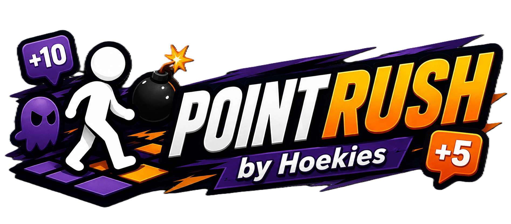

<p align="center">
  
</p>

<p align="center"><strong>Loop de route. Pak de punten. Saboteer je vrienden.</strong></p>

PointRush is een GPS-gebaseerd buiten-spel voor teams. Teams lopen een route langs geocoördinaten, beantwoorden vragen op locatie en proberen elkaar te saboteren met speciale items. Beheer van routes, spelers en live-voortgang gaat via een ingebouwd beheer, op de computer en de telefoon.

---

## Functies

### Voor spelers
- GPS-navigatie naar opeenvolgende route-punten, met stippellijn naar het actieve punt zodra dat zichtbaar wordt
- Vragen op locatie (meerkeuze, open antwoord, foto-opdracht)
- Speciale items oppakken en inzetten op andere teams
- Andere teams alleen zichtbaar met een radar
- Teamnaam en icoon kiezen
- Als app te installeren (volledig scherm), met uitleg voor Android en iPhone
- Melding als de organisatie een punt vrijgeeft of het spel stopt

### Voor beheerders
- Routes aanmaken met punten, vragen en speciale items
- **Sequentieel** of **Verspreid (lus)** modus per route
- Verspreid-modus: automatische puntgenerator in cirkelpatroon, met versleepbaar middelpunt en ghost-voorvertoning
- Teams starten verspreid over de route, met ongeveer gelijke aanloop vanaf de startplek
- Spelers aanmaken, in-/uitschakelen, verwijderen en inloggegevens beheren; inloggegevens versturen via WhatsApp
- Een speler direct uitloggen (daarna kan het team op elke telefoon opnieuw inloggen)
- Dashboard met stappenplan, spelleider (wat vraagt aandacht), stand, tijdlijn en details per speler
- Live kaart met vaste kleur per speler, speler volgen en spoor van de laatste 10 minuten
- Scherpe vectorkaart (OpenFreeMap) in licht, donker of luchtfoto (PDOK), met parkeerplaatsen, huisnummers en alleen openbare paden
- Replay in 3D: schuin kijken, draaien en een camera die meebeweegt
- Route-editor: punten op de weg zetten, route leegmaken, items langs de wegen
- Wachttijd van spook of plek zooi inkorten, punt vrijgeven, spel per speler stoppen
- Pushmeldingen bij een nieuwe foto of hulpvraag (ook op een horloge)
- Berichten naar alle teams, tussenstand, uitslag vrijgeven en spelrapport als PDF
- Voorproefje van een route op één A4 (zonder antwoorden)
- Meerdere spelers tegelijk aanmaken; inloggegevens per team via WhatsApp of als printbare inlogkaartjes
- Testronde in de route-editor; punten toevoegen of verwijderen tijdens een lopend spel; wijzigingen naar spelers sturen
- Foto's één voor één keuren, ook vanuit de pushmelding
- Routes exporteren, importeren en kopiëren; versienummer en laatste update in het menu
- Punten importeren uit een GPX/KML-bestand, een lijst met coördinaten of Google Maps-links
- Vragenbank: een vraag uit een andere route overnemen in de vraag-editor, op soort, met favorieten
- Punten handmatig aanpassen per team (bonus of aftrek met reden, in tijdlijn en rapport)
- Eindtijd van het spel: spelers zien een aftelklok en een waarschuwing 10 minuten van tevoren
- Inloglink zonder wachtwoord voor een team, een gekozen tijd geldig (daarna automatisch uitgelogd)
- Bericht aan één team, telefoonnummer per team (bellen en WhatsApp direct naar de juiste chat)
- Replay op de live kaart: het hele spel versneld afspelen
- Spel pauzeren voor alle teams (eindtijd schuift mee)
- 🧪 Testteam: zelf een rondje lopen met een testtegenstander die items op je gooit; telt nergens mee
- ⚡ Bonusvraag (meerkeuze of foto) die na een ingestelde speeltijd bij alle teams tegelijk verschijnt; de eerste goede krijgt de meeste punten
- Helpers: een tweede, beperkte inlog die alleen meekijkt, foto's keurt en punten vrijgeeft
- Statistiek per vraag: hoeveel teams een vraag goed hadden en welke foute antwoorden vaak voorkwamen
- Duidelijke routestatus: Concept → Klaar → Actief, met per scherm één opvallende knop voor de volgende stap
- Vraag-editor met opslaan altijd in beeld, waarschuwing bij niet-opgeslagen wijzigingen en geavanceerde instellingen uitklapbaar
- Foutmeldingen die uitleggen wat er misging en hoe je het oplost
- Bij het opslaan van een vraag kies je meteen de naam van het punt (met voorstellen uit de vraag)
- Live kaart met lagen (sporen, items) en licht/donker/luchtfoto in één paneel; 📺 beamerscherm (kaart, stand, gebeurtenissen) via een geheime link
- Per vraag: 🔀 husselen, 🔊 geluid, ⏱️ tijdslimiet; per route: 🧩 puzzelwoord, ⛔ verboden gebieden; 📦 sjablonen bij een nieuwe route
- 🩺 Systeemcheck (migraties, opslag, instellingen), 💾 back-up van alle routes, 📸 fotoalbum om te delen
- Route-editor: 🚶 proeflopen (als testspeler over de kaart klikken), meerdere punten tegelijk aanpassen, straatnamen, 💡 vraagideeën
- Helpers aan- en uitzetten, net als spelers
- 🚀 Eerste stappen bij een nieuwe route (startpunt, finish, teams en km, punten maken, items automatisch, vragen, controleren)
- Spelersapp: afstand en richting naar het volgende punt; tegenstanders binnen 25 meter zichtbaar; één knop voor licht/donker/luchtfoto (begint licht); op volgorde optioneel de hele route zichtbaar, met doorlooppunten (zonder scherm); speelt door zonder bereik (wachtrij); kaart van het speelgebied wordt bewaard voor plekken zonder bereik; zuinig met GPS en batterij; open antwoorden met één tikfout tellen goed; 🔆 scherm aan laten; 🏅 oorkonde bij de finish
- Grafisch: confetti bij goed antwoord en finish, podium bij de uitslag, uitslag als deelbare afbeelding, puntenverloop-grafiek op het dashboard, replay als video (🎬), teamkleur in de spelersapp, zwevende pinnen op de kaart
- QR-code op het inlogkaartje logt direct in; plaats van de route (uit het startpunt) in het overzicht
- Per route: eigen huisstijl (kleur, logo, welkomstfoto; logo ook op uitslag, oorkonde en rapport) en geluidset (klassiek, arcade, zacht, feest); 🗳️ stemvraag (de meerderheid krijgt de punten)
- Spelers: status-stip, zoeken en sorteren, teamnaam aanpassen, alle inlogkaartjes in één keer
- Antwoorden: inklapbaar per team, 🤏 bijna goed, achteraf goed rekenen voor alle teams, fotogalerij met opmerking voor het team, 📥 Excel-export
- Dashboard met mini live kaart; nieuwe punten krijgen vanzelf de straatnaam; 🐞 foutlogboek in de Systeemcheck; GPS-plekken na 30 dagen automatisch weg

### Speciale items
Bij **Sequentieel** liggen alleen Plek zooi-vallen op de kaart en krijgt elk team bij de start één Banaan.

| Item | Effect |
|---|---|
| ⭐ Ster | Geeft direct bonuspunten |
| 🔴 Verdubbeling | Volgende vraag met pluspunten levert dubbele punten op (minpunten nooit) |
| 👻 Spook | Verbergt het doelpunt van een team 10 minuten |
| 💣 Bom | Trekt punten af van een doelteam |
| 🔄 Wissel | Wisselt scores met een doelteam |
| 🦹 Dief | Steelt meteen de punten van een goede vraag van een doelteam |
| 📡 Radar | Onthult exacte GPS-posities van alle teams voor 2 minuten |
| 🍌 Banaan | Het volgende punt van een tegenstander ruilt van plek met het punt daarna (nooit start of eindpunt) |
| ⛔ Plek zooi | Onzichtbare val — blokkeert kaart en voortgang bij betreden |

---

## Tech stack

| Laag | Technologie |
|---|---|
| Framework | Next.js 14 (App Router, TypeScript) |
| Database & Auth | Supabase (PostgreSQL + realtime) |
| Kaart | Leaflet.js |
| Hosting | Vercel |
| Stijl | CSS custom properties, Space Grotesk |
| Iconen beheer | lucide-react (lijn-iconen); speler-app: emoji |

---

## Lokaal draaien

### Vereisten
- Node.js 18+
- Een Supabase-project

### Installatie

```bash
git clone https://github.com/Hoekies/plekkieznloatst.git
cd plekkieznloatst
npm install
```

### Omgevingsvariabelen

Maak een `.env.local` aan in de root:

```env
NEXT_PUBLIC_SUPABASE_URL=https://jouw-project.supabase.co
NEXT_PUBLIC_SUPABASE_ANON_KEY=jouw-anon-key
SUPABASE_SERVICE_ROLE_KEY=jouw-service-role-key
```

### Database

Voor een **nieuw, leeg** Supabase-project: voer `supabase/migrations/001_schema.sql` in één keer uit in de Supabase SQL Editor. Dat bestand bevat het volledige schema: de samengevoegde oude migraties 001–038 en daaronder de latere migraties 002–026, elk onder een kopje met hun oude nummer (meldingen in de app en de Systeemcheck noemen dat nummer, bijv. "migratie 023"). Bovenin staat wat je daarna nog in het dashboard moet doen (storage-buckets en de beheerder).

**Nieuw: `002_atomaire_acties.sql`** (28 oktober 2026, na de audits): scores, itemwissels en de banaan in één stap in de database, en één vraag per punt. Draai dit bestand één keer in de SQL Editor; tot dan werkt de app op de oude manier verder en meldt de Systeemcheck het. **Nieuw: `003_afschermen_en_startitems.sql`**: spelers kunnen de tabel `routes` (met het puzzelwoord) niet meer zelf lezen, en startitems worden maar één keer per spel uitgedeeld.

De bestaande database heeft dit allemaal al (gecontroleerd op 25 oktober 2026). Nieuwe wijzigingen komen weer als `002_…`, `003_…` enz. in dezelfde map; draai ze op volgorde in de SQL Editor (ze mogen vaker gedraaid worden). De oude losse migraties staan in de git-geschiedenis.

### Starten

```bash
npm run dev
```

De app draait op [http://localhost:3000](http://localhost:3000).

### Controle vóór een push

```bash
npm run controle
```

Types, lint, een zelftest van de spelregels (`scripts/zelftest.ts`) en een proefbouw (in `.next-controle`, zodat `npm run dev` gewoon door kan draaien). Na `git config core.hooksPath .githooks` gebeurt dit vanzelf bij elke `git push`; gaat iets mis, dan wordt er niet gepusht.

### Admin-account aanmaken

Maak een gebruiker aan in Supabase Authentication en zet in `app_metadata`:

```json
{ "rol": "admin" }
```

---

## Projectstructuur

```
app/
  admin/          → Beheer (routes, spelers, dashboard, live)
  speler/         → Spelersapp (kaart, vragen, finish)
  api/            → API-routes (Next.js Route Handlers)
  login/          → Inlogpagina
components/
  admin/          → Admin-componenten (RouteEditorShell, LeafletKaart, …)
  speler/         → Speler-componenten (SpelerKaart, VraagPopup, …)
lib/              → Supabase-clients, geo-utilities
types/            → TypeScript interfaces (database.ts)
supabase/
  migrations/     → SQL-migraties
docs/             → Beheerdershandleiding, spelersinstructies
```

---

## Documentatie

- [Beheerdershandleiding](docs/beheerdershandleiding.md)
- [Spelersinstructies](docs/spelersinstructies.md)
- Speluitleg per speltype: [Sequentieel](docs/spel-sequentieel.md) · [Verspreid](docs/spel-verspreid.md)
- Technisch ontwerp: [technisch-ontwerp.md](docs/technisch-ontwerp.md)

### Afbeelding-handleidingen genereren

Voor elke speluitleg hierboven staat een kant-en-klare
ChatGPT-prompt om er een geïllustreerde posterhandleiding van te laten maken:
[Sequentieel](docs/afbeelding-prompt-sequentieel.md) · [Verspreid](docs/afbeelding-prompt-verspreid.md).
Plak de codeblok uit zo'n bestand in ChatGPT (met beeldgeneratie) om de afbeelding te maken.
Voor een korte, printbare spelershandleiding op A5 met het logo: [spelers-a5](docs/afbeelding-prompt-spelers-a5.md).

---

## Licentie

Privéproject — [Hoekies](https://hoekies.nl) 2026
